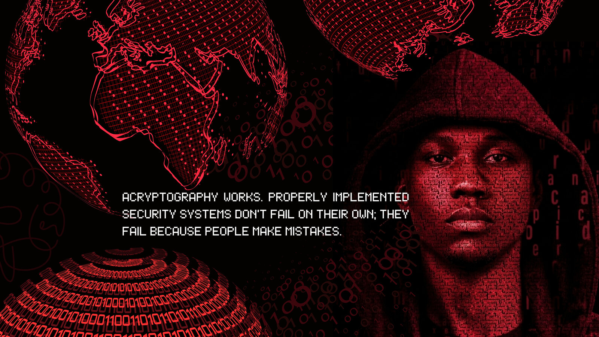

 

# Israel Cassute (Zuba)

  
  
  
  

 

Engenheiro Informático e Comunicação pela **Universidade Óscar Ribas (UÓR)**, natural de Luanda, Angola. Selecionado pelo programa **Frontier Tech Leaders (UNDP/ONU)** para especializações de elite na **NYU** e **Stanford**. Fundador da **The Code Minds**, focado em resolver problemas complexos através de IA e em garantir a soberania digital através da Cibersegurança.

 

## 🔐 Projetos de Segurança — Provas de Trabalho

<table>
<tr>
<td width="33%" valign="top">

**🕵️ [Ethical Hacking Lab](https://github.com/Israzuba0023/Ethical-Hacking-DIO-Challenge)**

Pentest completo contra Metasploitable2 (Kali Linux). Recon com Nmap, brute-force FTP com Medusa, PoC de acesso e plano de mitigação (Fail2Ban, SFTP/SSH).

</td>
<td width="33%" valign="top">

**🦠 [Malware Analysis Lab](https://github.com/Israzuba0023/Malware-Analysis-Lab-DIO)**

Simulação de ransomware (Fernet/AES) e keylogger em Python, em ambiente controlado, com disclaimer ético e evidência documentada.

</td>
<td width="33%" valign="top">

**✅ [SwagLabs QA Tests](https://github.com/Israzuba0023/swaglabs-qa-tests)**

Documentação de QA manual — user stories, casos de teste BDD — aplicada a um ambiente de e-commerce de teste.

</td>
</tr>
</table>

 

## 📜 Certificações

| Certificação | Instituição |
|:---|:---|
| 🛡️ HakyOff Certified Penetration Tester (HCPT) | HakyOff |
| 🛡️ Penetration Testing Web | HakyOff |
| 🔒 Cybersecurity: Developing a Program for Your Business | Kennesaw State University |
| 🔒 Introduction to Cyber Security Specialization | New York University |
| 🤖 Machine Learning and Artificial Intelligence | Stanford University |

 

## 🧰 Stack Técnico

**Segurança & Redes**

**IA & MLOps**

**Infraestrutura & DevSecOps**

<b>🧩 Também trabalhei com (stack secundário)</b>

 

 

## 📊 Estatísticas GitHub

 

## 🌐 Onde me encontrar

